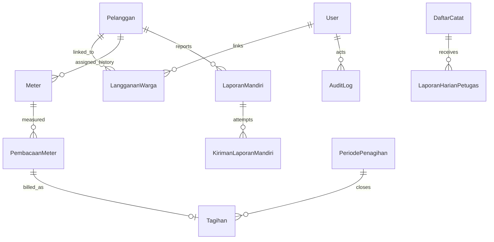

# Rancangan Arsitektur Awal Aplikasi Baca Meter Air

**Versi:** 0.3 — scope dan model direkonsiliasi dengan aplikasi saat ini; diselaraskan dengan keputusan dokumentasi 1 November 2026
**Tanggal:** 1 November 2026
**Konteks repository:** implementasi saat ini menggunakan Next.js 16, Hono pada route API Next.js, PostgreSQL, Prisma ORM 7, dashboard web, dan alur aplikasi petugas yang bekerja offline.

Dokumen kebutuhan produk dan rencana rilis: [PRD](./PRD.md), [Definisi MVP](./MVP.md), dan [Roadmap](./ROADMAP.md). Aturan domain: [kondisi catat](./ATURAN-KONDISI.md), [verifikasi](./VERIFIKASI.md), [RBAC](./RBAC.md). Peta dokumen dan register OPEN: [Indeks](./INDEKS.md#register-open).

**Peran dokumen:** rancangan target teknis. Bukan status implementasi (lihat [STATUS](./STATUS.md)) dan bukan aturan bisnis (lihat dokumen aturan).

## 1. Tujuan dan keputusan awal

Bangun sistem pencatatan meter yang menghasilkan data terukur, dapat diverifikasi, dapat ditagihkan ulang secara reproduktif, dan dapat diaudit. Sasaran desain adalah _modular monolith_ terlebih dahulu, bukan microservices:

- **Aplikasi mobile petugas:** mengambil daftar kerja, menyimpan pekerjaan di database lokal, menangkap bukti, dan menyinkronkan operasi saat jaringan tersedia.
- **Dashboard web:** pengelolaan pelanggan/aset/rute, pemantauan, verifikasi, koreksi, pengaturan tarif, closing, dan rekonsiliasi.
- **API Hono:** satu pintu untuk aturan bisnis, otorisasi, validasi, workflow, dan koneksi database.
- **PostgreSQL:** sumber kebenaran untuk transaksi, status resmi, penagihan, dan audit.
- **Object storage privat:** foto/video bukti; database hanya menyimpan object key dan metadata.
- **Worker/job runner:** proses sinkronisasi besar, ekspor, notifikasi, atau closing yang harus dapat dilanjutkan setelah kegagalan.

Hono saat ini dipasang di route handler Next.js. Pertahankan model itu untuk tahap awal bila deployment dan batas runtime mendukungnya. Jangan menjalankan logika bisnis yang berbeda di Server Actions, route handler Next, dan Hono; semua perubahan domain harus melewati service/use case yang sama. Pertimbangkan memisahkan API/worker sebagai deployment terpisah hanya bila kebutuhan skala, isolasi runtime, atau operasi memang terbukti.

### Keputusan scope dan batas yang masih terbuka

**Sudah diputuskan:** aplikasi ini hanya untuk meter air; satu akun warga dapat menautkan beberapa sambungan; laporan mandiri tetap disimpan sebagai sumber bukti dan saat diverifikasi disinkronkan ke antrean `LaporanHarianPetugas`; penimpaan tahap lama memerlukan role V3 ke atas dan mereset tahapan agar Petugas mengesahkan ulang; periode terkunci tidak dapat diubah; verifikasi Mandiri tidak menerbitkan `PembacaanMeter` resmi; jendela laporan mandiri dikonfigurasi per tanggal; laporan anonim tetap diterima sebagai kiriman berisiko rendah yang wajib diverifikasi.

`LanggananWarga` saat ini adalah klaim tautan dan belum membuktikan kepemilikan. API akun harus memastikan `pelangganId` yang dikirim memang tertaut ke `userId` yang login, tetapi tautan itu bukan pengganti verifikasi identitas. Sampai mekanisme verifikasi kepemilikan diputuskan, laporan akun maupun tamu tetap berstatus menunggu dan tidak langsung mengubah hasil/tagihan.

**Belum disahkan (diperbarui 1 November 2026):** rumus taksiran dan pemakaian minimum untuk billing produksi, mapping operasional untuk kode legacy yang ambigu (OPEN-10), SLA verifikasi, otoritas persetujuan koreksi pasca-tagihan, jadwal retensi catatan audit resmi, dan penanganan finansial bila pembacaan dikoreksi setelah tagihan terbit. **Sudah diputuskan untuk pilot (G0, 31 Oktober; lihat [STATUS](./STATUS.md)):** ring V1/V2/V3 (sumber: [aturan verifikasi](./VERIFIKASI.md)), retensi foto/GPS/kontak/log pribadi 3 bulan, dan OTP ke nomor yang terverifikasi pada data resmi. Konflik retensi 3 bulan dengan arsip immutable: OPEN-07. Rancangan ini tidak menetapkan kebijakan tarif atau refund.

## 2. Batas konteks dan model domain

Pisahkan tiga macam data:

1. **Kiriman sumber:** laporan petugas dan warga disimpan dengan sumber dan bukti. Percobaan laporan mandiri disimpan append-only; retry tidak boleh mengganti bukti lama.
2. **Hasil resmi:** satu baris `PembacaanMeter` per meter/periode, melalui validasi petugas, memiliki sumber, nilai stand, pemakaian terukur/tagih, dan alasan.
3. **Tagihan historis:** `Tagihan` membekukan hasil saat diterbitkan. Koreksi pembacaan tidak diam-diam menghitung ulang atau menimpa tagihan lama.



### Entitas inti

| Konsep                 | Model canonical saat ini                                                                  | Catatan                                                                                                                                                                                                                          |
| ---------------------- | ----------------------------------------------------------------------------------------- | -------------------------------------------------------------------------------------------------------------------------------------------------------------------------------------------------------------------------------- |
| Akun dan sambungan     | `User`, `LanggananWarga`, `Pelanggan`                                                     | Relasi akun-pelanggan many-to-many; klaim tautan belum membuktikan kepemilikan.                                                                                                                                                  |
| Meter dan riwayat      | `Meter` (`meter`)                                                                         | Baris meter menyimpan pelanggan dan `isAktif`; jangan menambah tabel assignment paralel sebelum inventaris dinormalisasi.                                                                                                        |
| Periode dan rute kerja | `PeriodePenagihan` (`periode_penagihan`), `DaftarCatat`                                   | `PeriodePenagihan` hanya punya status `BERJALAN/TERKUNCI`; jendela laporan warga disimpan di `Konfigurasi`, bukan tabel periode baru.                                                                                            |
| Intake petugas         | `LaporanHarianPetugas` (`laporan_harian_petugas`)                                         | Tetap menjadi sumber petugas; pencatat ditautkan lewat `Pencatat`, bukan langsung ke `User`.                                                                                                                                     |
| Intake warga           | `LaporanMandiri` (`laporan_mandiri`), `KirimanLaporanMandiri` (`kiriman_laporan_mandiri`) | Tabel pertama adalah status antrean terkini; tabel kedua menyimpan setiap percobaan/bukti secara append-only.                                                                                                                    |
| Hasil resmi            | `PembacaanMeter` (`pembacaan_meter`)                                                      | Satu sumber hasil resmi untuk petugas dan mandiri; pemakaian tagih berbeda dari delta stand pada banyak data historis. Kunci unik yang dilaporkan STATUS adalah `[meterId, periode]`; kunci domain target dan kasus MB: OPEN-06. |
| Tagihan                | `Tagihan` (`tagihan`)                                                                     | Dokumen historis; tidak diperbarui otomatis saat koreksi hasil baca.                                                                                                                                                             |
| Audit                  | `AuditLog` (`audit_log`)                                                                  | SQL harus memakai nama tabel hasil `@@map`, bukan `"AuditLog"`.                                                                                                                                                                  |

Tidak ada skema listrik. Nilai fisik pembacaan air saat ini disimpan dalam bilangan bulat m³. Perubahan presisi/satuan harus didasarkan pada karakteristik meter dan kebijakan yang disahkan.

Analisis CSV, hasil ukur-versus-tagih, dan pemetaan label legacy didokumentasikan di [`REKONSILIASI.md`](./REKONSILIASI.md). Sampel hanya mencakup satu periode; angka tersebut tidak cukup untuk mengesahkan rumus taksiran atau anomali.

## 3. Skema PostgreSQL dan integritas

### Constraint di database

Handler melakukan validasi untuk pesan yang ramah pengguna; constraint PostgreSQL menjadi penjaga terakhir terhadap race condition dan jalur impor.

- PK internal stabil; unique constraint untuk nomor sambungan, identitas operasi sinkronisasi, referensi pembayaran provider, serta satu invoice per sambungan/periode bila aturan bisnis memang demikian.
- FK eksplisit dan kebijakan `ON DELETE` yang sesuai. Data historis billing tidak boleh hilang akibat penghapusan pelanggan; utamakan nonaktif/soft delete dan FK restrict untuk data finansial.
- `CHECK` untuk rentang nilai register, koordinat, nominal non-negatif, bulan yang valid, dan konsistensi nilai dasar.
- Check constraint tidak dapat menggantikan workflow; contoh `standAkhir >= standLalu` tidak berlaku bagi semua rollover/penggantian meter.
- Jangan menaruh status dan field identitas yang saling bertentangan tanpa invariant. Pertimbangkan status workflow eksplisit dengan transisi yang dikontrol.

Satu meter aktif pada satu sambungan merupakan invariant yang cocok ditegakkan dengan partial unique index setelah data duplikat dibersihkan:

```sql
CREATE UNIQUE INDEX meter_satu_aktif_per_pelanggan
  ON "meter" ("pelangganId")
  WHERE "isAktif" = true;
```

Nama dan kolom mengikuti model aktual. Sebelum menambah partial unique index, jalankan dan tinjau preflight duplikasi pada database target, bersihkan konflik secara terkontrol, lalu buat migration Prisma yang direview. Draft SQL lama bukan migration dan tidak boleh dijalankan langsung; nomor meter fisik juga tidak boleh diberi unique constraint sebelum duplikat/placeholder legacy diselesaikan.

### Indeks awal berdasarkan query

Mulai dari kebutuhan query nyata, bukan menambahkan indeks ke semua kolom (nama kolom pada daftar berikut ilustratif berbahasa Inggris; padankan dengan nama model/kolom aktual di `prisma/schema` sebelum dibuat):

- `(billing_period_id, route_id, work_status)` untuk daftar kerja petugas/supervisor.
- `(service_connection_id, period)` untuk riwayat pembacaan dan pemeriksaan duplikasi.
- `(status, received_at)` untuk antrean verifikasi.
- `(customer_id, period)` untuk histori tagihan dan invoice.
- `(status, due_at)` untuk tunggakan.
- `(provider, external_reference)` unique untuk pembayaran dan webhook.
- GIST untuk pencarian spasial PostGIS; ukur query distance/nearest-neighbor dan pilih operator/index yang memang dapat digunakan.

Gunakan `EXPLAIN (ANALYZE, BUFFERS)` dengan data yang representatif sebelum menyimpulkan indeks atau partisi. Partisi bukan langkah awal; terapkan setelah ukuran tabel, retensi, dan pola query menunjukkan manfaat.

### Skema migrasi operasional

- Perubahan schema melalui migration yang direview; jangan mengandalkan `db push` di produksi.
- Sebelum unique constraint baru, audit dan bersihkan duplikasi, tulis backfill yang dapat dilanjutkan, lalu validasi hasil.
- Uji migrasi terhadap salinan data berukuran realistis; ukur lock dan waktu deploy.
- Database produksi hanya dapat ditulis oleh identitas runtime yang diperlukan; migrasi memakai kredensial terpisah.
- Gunakan connection pooling yang sesuai lingkungan serverless/hosted PostgreSQL. Batasi koneksi maksimum aplikasi dan observasi pool saturation.
- Backup terjadwal/PITR sesuai kapabilitas provider dan lakukan uji restore berkala. Backup yang belum pernah dipulihkan belum tervalidasi.

## 4. Alur bisnis pembacaan meter

### Workflow yang disarankan

1. **Buka periode baca:** gunakan `PeriodePenagihan` yang ada dan bekukan populasi/rute melalui `DaftarCatat`. Jangan membuat `PeriodeTagih` kedua.
2. **Catat petugas:** endpoint petugas menyimpan laporan dengan identitas `Pencatat` dari sesi/penugasan, bukan dari body request. Kiriman offline perlu idempotensi per operasi pada tahap sinkronisasi.
3. **Lapor mandiri:** `/api/public/lapor-meter` tetap menerima kiriman tamu ber-rate-limit yang selalu `MENUNGGU`; `/api/v1/laporan-mandiri` mengharuskan role warga dan memeriksa `LanggananWarga` berdasarkan akun login. Jika akun login memakai endpoint publik, sambungan juga harus cocok dengan tautannya. Tautan belum dianggap bukti kepemilikan.
4. **Jendela dan periode:** konfigurasi `LAPOR_MANDIRI_TANGGAL_BUKA` dan `LAPOR_MANDIRI_TANGGAL_TUTUP` (default 1–25, rentang 1–28) menjadi aturan server. Nilai dapat diatur melalui halaman `/pengaturan` atau `PATCH /api/v1/konfigurasi/lapor-mandiri/jendela`; kedua nilai disimpan atomik. Server menghitung periode WIB dan menyediakan jadwal ke client; client tidak menentukan periode.
5. **Simpan intake:** kedua pintu mandiri memakai satu service persisten untuk pemeriksaan duplikasi, status antrean, dan rekam append-only setiap kiriman. Bukti kiriman ulang memiliki object key berbeda dan tidak menimpa foto sebelumnya.
6. **Verifikasi:** petugas memeriksa foto, sambungan, meter yang aktif, periode, dan kewajaran hasil. Laporan tamu maupun akun tidak langsung mengubah `PembacaanMeter`.
7. **Hasil resmi:** laporan petugas dan warga diproses menjadi satu model `PembacaanMeter`. Simpan sumber, stand awal/akhir, `pemakaianRiil`, `pemakaianM3` yang ditagihkan, dan alasan/metode jika berbeda.
8. **Closing:** mekanisme closing/tagihan yang ada tetap sumber status periode dan dokumen tagihan. Proses koreksi hasil baca tidak boleh mengubah ulang tagihan yang sudah terbit.
9. **Koreksi pasca-terbit:** ajukan revisi dengan nilai sebelum/sesudah, bukti, alasan, pengaju, dan penyetuju yang berbeda. Perubahan hasil resmi harus berjejak; tagihan lama tetap immutable. Penanganan nilai kredit/debit, refund, atau saldo pelanggan berada di luar fase ini dan memerlukan rancangan billing tersendiri.

### Kasus tepi yang perlu diputuskan sebagai aturan bisnis

| Keadaan                            | Perlakuan sistem yang disarankan                                                                                                                                                                                                                                                                                                                |
| ---------------------------------- | ----------------------------------------------------------------------------------------------------------------------------------------------------------------------------------------------------------------------------------------------------------------------------------------------------------------------------------------------- |
| **Rollover counter**               | Periksa digit/kapasitas register perangkat dan jenis meter. Hitung konsumsi lintas rollover hanya bila nilainya masuk akal dan sesuai konfigurasi. Simpan flag/metode kalkulasi; jika data alat tidak cukup, kirim ke review, bukan menjadikan pemakaian nol.                                                                                   |
| **Meter diganti**                  | Pertahankan baris meter lama dan buat baris meter baru; simpan waktu efektif, stand cabut/pasang, serta segel. Kalkulasi pemakaian periode menjadi jumlah segmen yang sah. Jangan menyamakan ini dengan counter mundur biasa.                                                                                                                   |
| **Meter rusak/mati/terbalik**      | Catat kondisi dan bukti; hasil terukur dan nilai tagih/taksiran adalah dua atribut berbeda. Gunakan kebijakan taksiran yang disahkan, alasan, dasar periode pembanding, rentang berlakunya, dan approval.                                                                                                                                       |
| **Rumah terkunci/tidak ada akses** | Catat kondisi akses yang tersedia pada enum `KondisiCatat` (lihat [codebook](./CODEBOOK.md); mis. `TERHALANG`) beserta alasan, waktu, dan bukti sesuai kebijakan; `NO_ACCESS` pada rancangan awal bukan nilai enum aplikasi. Jangan membuat angka stand/pemakaian palsu; jadwalkan kunjungan ulang atau gunakan metode estimasi yang disetujui. |
| **Rumah kosong/tidak dipakai**     | Bedakan dari rumah terkunci. Angka nol hanya jika aturan dan bukti mendukung; jangan menghapus bea tetap secara otomatis kecuali tarif mengaturnya.                                                                                                                                                                                             |
| **Foto tidak tersedia**            | Simpan status kegagalan unggah secara eksplisit, retry terukur, dan kebijakan pengecualian berdasarkan kondisi. Foto tidak boleh membuat pembacaan tampak lengkap bila upload gagal.                                                                                                                                                            |
| **GPS tidak akurat/offline**       | Simpan koordinat, akurasi, waktu pengambilan dan status izin bila tersedia. Tandai sebagai sinyal review, bukan satu-satunya bukti kehadiran. Perangkat dapat dimanipulasi dan GPS indoor bisa meleset.                                                                                                                                         |
| **Angka abnormal**                 | Gunakan aturan berbasis histori, meter, musim, pelanggan, dan batas layanan. Simpan versi aturan/ambang yang memicu alert. Alert adalah alat bantu review, bukan pengganti keputusan manusia.                                                                                                                                                   |
| **Koreksi setelah tagihan terbit** | Simpan revisi append-only dengan maker-checker dan tautan ke tagihan terdampak. Jangan mengubah tagihan otomatis. Nota debit/kredit, saldo kredit, dan refund belum masuk lingkup implementasi ini.                                                                                                                                             |

## 5. Rancangan backend Hono

### Batas modul

Pisahkan router HTTP dari domain/service dan repository:

```text
src/lib/server/
  modules/
    laporan/        # laporan petugas/warga, verifikasi, hasil resmi
    pelanggan/      # pelanggan dan tautan akun warga
    meter/          # meter dan pembacaan resmi
    organisasi/     # pencatat, wilayah, rute, daftar catat
    tagihan/        # closing dan dokumen tagihan yang sudah ada
    audit/          # audit log
  domain/           # kalkulasi murni, transisi status, policy
  middleware/       # auth, RBAC/ABAC, request-id, rate limit
  lib/              # Prisma, object storage, error mapping
```

Nama folder adalah usulan target; jangan memindahkan seluruh repository sekaligus hanya demi penamaan. Refactor per vertical slice agar perilaku yang sudah digunakan tidak berubah tanpa pengujian.

### Endpoint dan kontrol

Permukaan yang tersedia saat ini:

- `GET /api/public/lapor-meter/jendela` — baca aturan tanggal/periode WIB yang dikonfigurasi.
- `POST /api/public/lapor-meter` — kiriman tamu multipart, rate-limited dan menunggu verifikasi.
- `POST /api/v1/laporan-mandiri` — kiriman akun warga, wajib sambungan yang tertaut ke akun.
- `PATCH /api/v1/laporan-mandiri/:id/verify` — memeriksa bukti, menyinkronkan stand ke antrean Petugas, dan mereset tahap lama; penimpaan V1–V3 memerlukan role V3 ke atas; tidak membuat `PembacaanMeter`.
- Endpoint catat petugas di `/api/v1/laporan-harian` tetap terpisah sebagai intake.

Laporan Mandiri hanya diverifikasi dan dikoreksi sebagai bukti. Penerbitan hasil resmi mengikuti aturan domain/use case laporan Petugas; jangan menambah tabel pembacaan resmi paralel.

Gunakan schema Zod bersama untuk body, query, parameter, dan respons yang penting. Tolak field tak dikenal pada DTO sensitif (`strict`/allow-list), dan jangan spread objek request langsung ke `data` Prisma. Terapkan batas panjang, ukuran batch, rentang tanggal, enum, dan ukuran upload. Dokumentasikan kontrak API, contoh error, versi, dan kode idempotensi.

Autentikasi menjawab “siapa”; otorisasi harus menjawab “boleh melakukan aksi ini pada objek ini?”. Gabungkan:

- role/permission untuk aksi;
- wilayah/rute/assignment untuk cakupan objek;
- tautan `LanggananWarga` untuk memastikan akun tidak dapat mengirim `pelangganId` yang tidak tertaut; jangan menganggap klaim tautan sebagai bukti identitas;
- separation-of-duties untuk koreksi dan approval;
- pemeriksaan status aktif serta pencabutan sesi/token.

Jangan mengandalkan menyembunyikan tombol di dashboard. Semua endpoint harus mengotorisasi ulang objek yang diminta. Pisahkan endpoint publik, internal, autentikasi, dan cron; endpoint yang sengaja tanpa sesi wajib memiliki autentikasi khusus, rate limit, validasi, dan output minimal.

### Transaksi dan konkurensi

Gunakan transaksi untuk perubahan yang harus berhasil/gagal sebagai satu kesatuan: approval + revision + audit; penciptaan invoice + invoice lines; pembayaran + ledger update. Pakai conditional update untuk mencegah dua persetujuan atas status lama (nama pada contoh ilustratif: `readingSubmission` kira-kira `LaporanMandiri`/`KirimanLaporanMandiri`, `PENDING_REVIEW` kira-kira `MENUNGGU`; sesuaikan dengan enum dan model aktual):

```ts
const changed = await tx.readingSubmission.updateMany({
  where: { id: submissionId, status: "PENDING_REVIEW" },
  data: { status: "APPROVED" },
})

if (changed.count !== 1) {
  throw new ConflictError("Submission sudah diproses atau tidak tersedia")
}
```

Transaksi untuk operasi multi-baris yang sensitif terhadap race dapat memakai isolation level lebih kuat. Tangani serialization/write conflict dengan retry terbatas untuk error yang memang dapat diulang; retry harus aman karena idempotensi. Jangan menjalankan upload object storage, panggilan HTTP, atau kalkulasi panjang di dalam transaksi database. Dokumentasi Prisma mengingatkan agar interactive transaction tetap singkat.

Closing puluhan ribu baris tidak perlu satu transaksi raksasa. Gunakan status/checkpoint yang sesuai dengan model closing yang sudah ada, batch kecil yang dapat diulang, constraint unik yang relevan, dan rekonsiliasi sebelum periode dikunci. Jangan menambahkan state machine periode kedua di luar `PeriodePenagihan`.

### Idempotensi dan sinkronisasi

- Untuk sinkronisasi petugas berikutnya, perangkat membuat `deviceId` dan `clientEventId` unik per operasi; server menyimpan pasangan identitas ini beserta hash payload dan hasil awal.
- Retry dengan ID dan hash yang sama mengembalikan hasil sebelumnya; ID sama dengan payload berbeda menghasilkan konflik yang dapat ditampilkan client.
- Batch memiliki batas jumlah item dan byte, hasil per item (`accepted`, `duplicate`, `conflict`, `rejected`), serta cursor/checkpoint.
- Duplikasi natural seperti sambungan/periode tidak selalu bermakna retry yang sama; jangan menganggap semua P2002 sebagai sukses jika isi request berbeda.
- Unggah foto secara terpisah atau dengan upload URL bertanda tangan berumur pendek; catatan mengacu object key setelah upload terkonfirmasi. Lakukan retry/resume dan rekonsiliasi object yatim.
- Terapkan backoff eksponensial dengan jitter untuk error sementara, batas retry, dan dead-letter/support state agar item gagal tidak hilang diam-diam.

## 6. Arsitektur aplikasi lapangan offline

Pola yang disarankan adalah _local-first_: layar membaca database lokal, operasi baru disimpan sebagai outbox, lalu worker mengirimkannya saat koneksi tersedia. Jangan menjadikan request HTTP yang sedang aktif sebagai satu-satunya salinan pekerjaan lapangan.

Data lokal minimal:

- periode dan daftar kerja yang ditugaskan;
- snapshot identitas sambungan yang dibutuhkan saat kunjungan;
- draft/submission, kondisi kunjungan, register, waktu lokal, GPS + accuracy;
- status setiap attachment (belum diunggah/terunggah/tertaut);
- status sinkronisasi, jumlah percobaan, error terakhir, dan server ID.

Pisahkan **waktu kejadian perangkat** dari **waktu penerimaan server**. Jam perangkat dapat salah; server menyimpan waktu penerimaan yang dipercaya. Konflik perubahan master data tidak diselesaikan dengan “last write wins”: kiriman pembacaan tetap jadi bukti, sedangkan resolusi identitas/rute/meter dilakukan server dan dapat ditahan untuk review.

Jaga pembacaan tetap dapat disimpan walau foto belum terkirim bila kebijakan mengizinkan; status bukti harus tetap `MISSING/UPLOAD_PENDING`, dan approval/closing dapat mensyaratkan bukti. Jangan menyimpan foto pelanggan secara publik; gunakan bucket privat, akses singkat, retensi yang disepakati, checksum, enkripsi, dan kontrol akses berdasarkan tugas.

Dokumentasi Android offline-first mendukung prinsip database lokal sebagai sumber baca UI, antrean perubahan, dan sinkronisasi saat jaringan tersedia. Untuk Flutter, terapkan pola yang sama melalui database lokal dan background task yang sesuai platform; periksa batasan sistem operasi aktual untuk pekerjaan latar.

## 7. Produksi, keamanan, dan operasi

### Checklist rilis

- [ ] **Identitas:** kebijakan sesi/token, rotasi secret, pencabutan akses, MFA untuk role berisiko, login rate limit, dan respons aman terhadap brute force.
- [ ] **Otorisasi:** uji object-level dan function-level authorization untuk setiap role; uji kepemilikan pelanggan, assignment petugas, dan perubahan role.
- [ ] **Validasi:** schema API ketat, batas request/batch/upload, validasi periode/satuan, perlindungan mass assignment, dan error yang tidak membocorkan detail internal.
- [ ] **Data:** FK/unique/check constraint, partial index yang diperlukan, prinsip least privilege, enkripsi koneksi/database/storage, dan klasifikasi data pribadi.
- [ ] **Bukti:** storage produksi yang tahan redeploy, privat, retensi teratur, akses terbatas, kebijakan pemindaian/format, serta penanganan upload yatim.
- [ ] **Audit:** actor, before/after, alasan, correlation ID, waktu server, proteksi akses dan retensi; jangan memasukkan password, token, atau data sensitif berlebih ke log.
- [ ] **Tagihan:** versi tarif yang disetujui dan berlaku, reproducible calculation, rounding policy, invoice idempotent, adjustment terkontrol, dan rekonsiliasi pembayaran.
- [ ] **Konsistensi:** uji race pada approval, pergantian meter, closing, dan webhook pembayaran; uji retry dan error serialization.
- [ ] **Kinerja:** uji beban rute yang representatif, batch sync saat beberapa petugas mengirim bersamaan, query plans, p95/p99, pool koneksi, dan storage throughput.
- [ ] **Keandalan:** health/readiness check yang tidak membocorkan informasi, timeout, retry terbatas, job checkpoint, alert, backup, dan uji pemulihan.
- [ ] **Rilis:** staging dengan data sintetis, migrasi ter-review, canary/rollback plan, secrets di secret manager, dan inventaris endpoint/versi.
- [ ] **Privasi:** minimisasi data, persetujuan dan tujuan penggunaan GPS/foto, retensi/penghapusan sesuai kebijakan dan hukum yang berlaku.
- [ ] **Keamanan:** threat model, dependency scanning, code review, pengujian otorisasi negatif, dan verifikasi terukur terhadap OWASP ASVS/API Security.

### Bottleneck yang paling mungkin

| Bottleneck                                                    | Mitigasi                                                                                                                                  |
| ------------------------------------------------------------- | ----------------------------------------------------------------------------------------------------------------------------------------- |
| Batch upload mengirim ulang ratusan data setelah timeout      | Idempotensi per item, cursor/checkpoint, hasil parsial, payload terbatas, exponential backoff+jitter.                                     |
| Upload foto/video memakai koneksi API dan memory terlalu lama | Direct/resumable upload ke object storage privat, validasi metadata dan ukuran server-side, worker untuk pemrosesan lanjutan.             |
| Kueri daftar kerja melakukan N+1 query                        | Muat relasi secara set-based, indeks sesuai filter, pagination/cursor; ukur query dengan data realistis.                                  |
| Banyak staf membuka antrean verifikasi bersamaan              | Cursor pagination, filter berbasis indeks, summary/query agregat, klaim tugas bila diperlukan, optimistic concurrency/conditional update. |
| Job closing memegang transaksi lama                           | Job resumable, chunked writes, checkpoint, constraint unik, validasi hasil, dan finalization terpisah yang atomik.                        |
| Pool koneksi PostgreSQL habis                                 | Pool terukur untuk jumlah instance, connection pooling terkelola, concurrency limit worker, timeout dan observasi jumlah koneksi.         |
| GPS/anomali menghasilkan terlalu banyak false positive        | Simpan accuracy/konteks; ukur tingkat false-positive; gunakan sebagai sinyal review yang dapat dikalibrasi, bukan auto-reject.            |

## 8. Roadmap implementasi

> Penomoran Tahap 0–4 di bagian ini adalah urutan kerja teknis awal. Bukan penomoran Tahap 0–5 pada [ROADMAP](./ROADMAP.md) maupun gerbang G0–G5 pada [STATUS](./STATUS.md); gunakan keduanya untuk urutan rilis.

### Tahap 0 — rekonsiliasi data dan kebijakan

Scope air, multi-sambungan akun, dua jalur intake mandiri, serta default jendela 1–25 sudah ditetapkan. Validasi mapping `ketcatat` dan alasan `pakai_drd` dengan pemilik data; sepakati aturan taksiran, retensi bukti, serta siapa pengaju/penyetuju koreksi. Jangan menebak makna kode historis yang belum memiliki codebook.

### Tahap 1 — perbaiki intake dan hasil resmi

Validasi tautan akun-ke-sambungan, pakai jendela WIB server-side dari konfigurasi, simpan percobaan laporan dan bukti tanpa overwrite, dan pastikan petugas tetap menjadi gerbang ke `PembacaanMeter`. Jalankan preflight duplikasi meter; tambahkan index unik parsial hanya sesudah data konflik diselesaikan.

### Tahap 2 — offline sync yang tahan retry

Definisikan kontrak batch, idempotency key, hash payload, per-item outcome, outbox lokal, checkpoint attachment, perangkat terdaftar, dan telemetry sync. Uji airplane mode, koneksi putus sebelum/sesudah respons, retry ganda, app restart, serta konflik payload.

### Tahap 3 — revisi pembacaan dan evaluasi billing

Tambahkan revision append-only dengan maker-checker dan penanda tagihan terdampak. Tagihan lama tetap tidak berubah. Rancangan saldo kredit/debit, nota koreksi, dan refund adalah fase billing terpisah; jangan mengimplementasikannya sebagai side effect revisi pembacaan.

### Tahap 4 — production hardening

Jalankan uji beban, security verification, restore drill, migrasi staging, observability, alert operasional, dan prosedur incident/correction. Jangan mengumumkan status production-ready hanya karena build berhasil.

## 9. Sumber resmi dan standar

Diakses 31 Oktober 2026. Rujukan ini mendukung prinsip desain; kebijakan teknis dan hukum yang berlaku tetap harus disahkan pemilik layanan/regulator.

1. **OWASP API Security Top 10 — 2023**
   <https://owasp.org/API-Security/editions/2023/en/0x11-t10/>
   Rujukan untuk Broken Object Level Authorization, Broken Authentication, Property/Function Level Authorization, resource consumption, sensitive business flows, misconfiguration, dan inventory API.
2. **OWASP Application Security Verification Standard — ASVS 5.0.0**
   <https://owasp.org/www-project-application-security-verification-standard/>
   Framework requirements untuk merencanakan dan memverifikasi kontrol keamanan aplikasi/API.
3. **OIML Recommendation R 49:2024 — Water meters for cold potable water and hot water**
   <https://www.oiml.org/en/publications/recommendations/49/2024/>
   OIML menyatakan edisi 2024 sebagai current dan menjelaskan scope metrologi/teknis meter air pada conduit tertutup. Referensi untuk karakteristik alat ukur, bukan spesifikasi lengkap aplikasi billing.
4. **PostgreSQL — Constraints**
   <https://www.postgresql.org/docs/current/ddl-constraints.html>
   Constraint CHECK, unique, foreign key dan integritas data di database.
5. **PostgreSQL — Partial Indexes**
   <https://www.postgresql.org/docs/current/indexes-partial.html>
   Partial index dan contoh unik untuk subset data; dasar penegakan satu assignment meter terbuka.
6. **PostgreSQL — Transaction Isolation**
   <https://www.postgresql.org/docs/current/transaction-iso.html>
   Tingkat isolasi dan perilaku transaksi konkurens; pilih dan uji isolasi untuk workflow berisiko.
7. **Prisma ORM 7 — Transactions and batch queries**
   <https://www.prisma.io/docs/orm/v7/prisma-client/queries/transactions>
   API transaksi interaktif/batch, isolation level, konflik tulis, dan retry `P2034`; dokumentasi juga memperingatkan transaksi interaktif panjang merugikan performa.
8. **Hono — Validation**
   <https://hono.dev/docs/guides/validation>
   Pola validasi request Hono dan integrasi validator pihak ketiga seperti Zod.
9. **Android Developers — Offline-first data layer**
   <https://developer.android.com/topic/architecture/data-layer/offline-first>
   Prinsip membaca dari sumber lokal, antrean/sinkronisasi saat jaringan kembali, dan desain offline-first.
10. **PostGIS — `ST_DistanceSphere`**
    <https://postgis.net/docs/ST_DistanceSphere.html>
    Fungsi jarak lon/lat dalam meter menggunakan model bumi bola; dokumentasi menyebut lebih cepat namun kurang akurat daripada jarak spheroid. Gunakan sesuai kebutuhan/ambang, bukan sebagai bukti lokasi yang sempurna.
