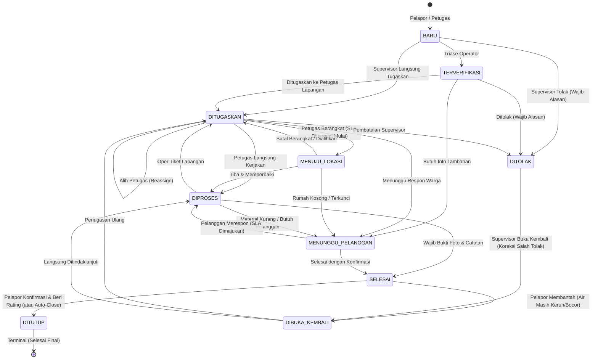

# DOKUMEN AUDIT & SKENARIO PENGUJIAN OPERASIONAL PENGADUAN AIR (WATER COMPLAINT)
**Status:** Audit & Refactor Selesai | Tingkat Enterprise PDAM / Utilitas Air Bersih  
**Arsitektur:** Next.js (App Router), Hono Server (RESTful API), Prisma ORM (PostgreSQL), Pure Domain State Machine  
**Lokasi File:** `AUDIT_PENGADUAN_AIR_SCENARIOS.md`

---

## 1. Ringkasan Eksekutif & Hasil Audit Arsitektur

Modul **Pengaduan Air** merupakan modul inti operasional pelayanan pelanggan dan penanganan gangguan lapangan (pipa bocor, meter rusak, air keruh, aliran mati). Pada audit sistem ini, dilakukan evaluasi menyeluruh terhadap:
1. **Integritas Alur Kerja (State Machine):** Menghilangkan transisi liar dan memastikan setiap pergantian status tercatat secara atomik di tabel linimasa (`RiwayatPengaduan`).
2. **Kepatuhan Terhadap SLA (Service Level Agreement):** Perhitungan target respons dan target selesai yang presisi, jeda otomatis saat menunggu respon pelanggan, serta pencegahan distorsi metrik.
3. **Pemisahan Tanggung Jawab (Separation of Concerns):** Pemisahan tegas antara aturan bisnis domain (`AlurPengaduan.ts`, `SLA.ts`), orkestrasi transaksi backend (`Pengaduan.service.ts`, `Publik.service.ts`), rute API (`Pengaduan.router.ts`), dan antarmuka dashboard pengguna (`PanelTindakan.tsx`, `PanelSelesai.tsx`).
4. **Proteksi Edge Cases Lapangan:** Penanganan tiket ganda, penugasan petugas valid non-pelanggan, verifikasi bukti foto penyelesaian, serta perlindungan penutupan tiket sepihak oleh petugas.

---

## 2. Matriks Status & Mesin Alur Kerja (Domain State Machine)

Setiap tiket mengikuti matriks transisi resmi di [`src/lib/domain/AlurPengaduan.ts`](file:///E:/Coding/azkaqueen/src/lib/domain/AlurPengaduan.ts):

### Aturan Bisnis Kunci:
1. **Tidak Ada Transisi Liar:** Router dilarang keras memanggil `prisma.pengaduan.update({ data: { status } })` secara manual. Seluruh transisi status wajib melalui fungsi atomik `transisiPengaduan(tx, opsi)` yang menyertakan pencatatan linimasa audit.
2. **Kewajiban Petugas Lapangan (`STATUS_BUTUH_PETUGAS`):** Status `MENUJU_LOKASI`, `DIPROSES`, dan `SELESAI` menuntut tiket telah memiliki penanggung jawab resmi (`ditugaskanKeId`).
3. **Kewajiban Catatan Penjelasan (`STATUS_WAJIB_CATATAN`):** Status `DITOLAK`, `MENUNGGU_PELANGGAN`, dan pembukaan kembali dari penolakan (`DIBUKA_KEMBALI`) wajib menyertakan catatan penjelasan tertulis agar pelapor memahami duduk perkara di portal publik.
4. **Bukti Foto Hasil Pekerjaan:** Transisi `SELESAI` wajib menyertakan URL foto hasil perbaikan di lapangan (`fotoPenyelesaianUrl`) dan ringkasan penyelesaian tertulis.
5. **Petugas Tidak Boleh Menutup Tiket Sepihak:** Status `DITUTUP` adalah hak mutlak pelapor (setelah puas dan memberi rating 1-5) atau melalui mekanisme `Auto-Close Sweep` setelah batas waktu konfirmasi kedaluwarsa.

---

## 3. Matriks Perhitungan Target SLA & Jeda Waktu

Standar waktu layanan (SLA) dihitung otomatis berdasarkan derajat keparahan pengaduan:

| Prioritas | Target Respons Pertama | Target Penyelesaian Masalah | Karakteristik Masalah Lapangan |
| :--- | :---: | :---: | :--- |
| **DARURAT** | 1 Jam | 8 Jam | Pipa distribusi utama pecah, banjir jalan raya, pencemaran limbah |
| **TINGGI** | 3 Jam | 24 Jam | Pipa dinas bocor deras, air padam total satu kawasan perumahan |
| **NORMAL** | 6 Jam | 72 Jam (3 Hari) | Air keruh sesaat, meter macet, tekanan air mengecil |
| **RENDAH** | 24 Jam | 168 Jam (7 Hari) | Permintaan cek tera meter, suara berisik pada pipa rumah |

### Mekanisme Stopwatch Jeda SLA (`MENUNGGU_PELANGGAN`):
- Ketika petugas menemui kendala di lokasi (misal rumah terkunci atau perlu konfirmasi warga) dan mengubah status ke `MENUNGGU_PELANGGAN`, sistem mencatat timestamp `jedaMulaiAt`.
- Selama berstatus jeda, penghitungan penalti waktu keterlambatan SLA dihentikan sementara (stopwatch di-pause).
- Saat tiket kembali ke status kerja (`DIPROSES`), selisih waktu jeda dihitung dalam menit:
  $$\Delta t_{\text{jeda}} = \max\left(0, \left\lfloor\frac{T_{\text{sekarang}} - T_{\text{jedaMulaiAt}}}{60.000}\right\rfloor\right)$$
- Target penyelesaian diperpanjang secara adil tanpa menyalahkan tim teknis:
  $$T_{\text{targetSelesaiBaru}} = T_{\text{targetSelesaiLama}} + \Delta t_{\text{jeda}}$$

---

## 4. Perbaikan dan Penguatan yang Diterapkan

Berikut adalah daftar temuan audit dan perbaikan konkret yang telah diimplementasikan:

1. **Sinkronisasi Definisi `STATUS_TERBUKA`:**
   - *Sebelum:* Pada beberapa modul, `STATUS_TERBUKA` tidak menyertakan `TERVERIFIKASI` dan `MENUJU_LOKASI`, menyebabkan tiket dalam status tersebut hilang dari agregasi metrik dashboard dan filter pelanggaran SLA.
   - *Sesudah:* Menggunakan referensi tunggal terpusat di `AlurPengaduan.ts` yang mencakup 7 status antrean kerja aktif (`BARU`, `TERVERIFIKASI`, `DITUGASKAN`, `MENUJU_LOKASI`, `DIPROSES`, `MENUNGGU_PELANGGAN`, `DIBUKA_KEMBALI`).
2. **Pencegahan Tiket Ganda (Spamming Prevention):**
   - *Sebelum:* Pelanggan yang melapor pipa bocor dapat mengirim formulir berulang kali menghasilkan banyak tiket terpisah untuk satu masalah yang sama.
   - *Sesudah:* Di `Publik.service.ts` dan `Pengaduan.service.ts`, sistem memeriksa apakah terdapat tiket aktif pada `nomorLangganan` + `jenis` pengaduan yang sama. Jika ada, sistem mengembalikan nomor tiket yang sedang aktif beserta status progresnya tanpa membuat baris baru.
3. **Penyaringan Role Penugasan:**
   - *Sebelum:* ID pengguna mana pun yang berstatus aktif bisa dijadikan penanggung jawab lapangan, termasuk pengguna biasa (role `USER`).
   - *Sesudah:* Ditegakkan aturan ketat bahwa penugasan tiket hanya dapat diberikan kepada staf operasional (role selain `USER`).
4. **Validasi Formulir Tindakan di Frontend:**
   - *Sebelum:* Tombol "Ditolak" dan "Menunggu Pelanggan" dapat diklik tanpa teks catatan, menghasilkan galat 400 Bad Request dari backend.
   - *Sesudah:* Tombol dinonaktifkan secara otomatis dan muncul peringatan visual (*helper alert*) sampai staf mengisi catatan penjelasan pada textarea.
5. **Koreksi Salah Tolak oleh Supervisor:**
   - *Sebelum:* Tiket yang terlanjur ditolak tidak bisa dibuka kembali oleh staf maupun manajer, memaksa pelanggan mengulang laporan baru.
   - *Sesudah:* Supervisor memiliki hak membuka kembali tiket `DITOLAK` (`DIBUKA_KEMBALI`) disertai kewajiban mengisi alasan koreksi pembatalan penolakan.

---

## 5. Skenario Pengujian Operasional Nyata (Real-World Test Scenarios)

### Skenario 1: Siklus Normal Penanganan Pipa Bocor (Happy Path)
- **Konteks:** Pelanggan (ID `01020300401`) melapor melalui web publik bahwa pipa depan rumahnya bocor deras (Prioritas TINGGI, SLA 24 Jam).
- **Langkah-langkah:**
  1. Pelanggan mengisi formulir di portal publik dan mengunggah foto kebocoran. Tiket terbit dengan status `BARU`.
  2. Operator Call Center di dashboard memverifikasi keabsahan laporan $\rightarrow$ Status berpindah ke `TERVERIFIKASI`.
  3. Supervisor memilih teknisi lapangan ("Budi Santoso - Teknisi Distribusi") $\rightarrow$ Status berpindah ke `DITUGASKAN` dan notifikasi push/in-app terkirim ke gawai petugas.
  4. Petugas di lapangan menekan tombol "Berangkat ke Lokasi" $\rightarrow$ Status berpindah ke `MENUJU_LOKASI`. Kolom `ditanganiMulai` tercatat.
  5. Petugas tiba di lokasi dan mulai menggali/memperbaiki pipa $\rightarrow$ Status berpindah ke `DIPROSES`.
  6. Pipa berhasil disambung dan dites tekanan. Petugas memotret hasil perbaikan dan menulis ringkasan $\rightarrow$ Status berpindah ke `SELESAI`. Kolom `konfirmasiBatasAt` terisi otomatis (misal: 48 jam ke depan).
  7. Pelanggan membuka tautan lacak tiket, melihat foto perbaikan, merasa puas, dan menekan "Konfirmasi Selesai" dengan rating Bintang 5 $\rightarrow$ Status berpindah ke `DITUTUP`.
- **Kriteria Keberhasilan:**
  - Status berpindah mulus sesuai urutan.
  - Setiap transisi tercatat di `RiwayatPengaduan`.
  - Jam respons pertama (`responsAt`) tercatat saat penugasan/berangkat.
  - Tiket tertutup secara final dengan data rating pelanggan.

---

### Skenario 2: Hambatan Lapangan & Penjeda Waktu SLA (Clock Pause)
- **Konteks:** Petugas tiba di lokasi aduan meter air macet, namun gerbang rumah pelanggan terkunci dan penghuni tidak di tempat.
- **Langkah-langkah:**
  1. Tiket berstatus `MENUJU_LOKASI` diubah ke `MENUNGGU_PELANGGAN` oleh petugas dengan catatan: *"Rumah dalam keadaan kosong dan pagar terkunci gembok. Mohon konfirmasi jadwal kunjungan kembali."*
  2. Sistem menyimpan timestamp `jedaMulaiAt = 10:00:00 WIB`.
  3. Stopwatch penalti SLA berhenti menghitung. Di papan pemantauan dashboard, tiket bertanda badge `Terjeda`.
  4. Pelanggan membalas melalui fitur Chat Tiket pada pukul `14:30:00 WIB` (durasi tunggu: 270 menit) mengonfirmasi kepulangan mereka.
  5. Petugas kembali ke lokasi dan mengubah status ke `DIPROSES`.
  6. Sistem menghitung durasi jeda $270$ menit, mengosongkan `jedaMulaiAt`, menambahkan `jedaTotalMenit = 270`, dan menggeser mundur `targetSelesaiAt` sebanyak $270$ menit.
- **Kriteria Keberhasilan:**
  - Keterlambatan waktu tidak dibebankan kepada staf lapangan.
  - Notifikasi dan riwayat internal/publik mencatat secara transparan alasan jeda penanganan.

---

### Skenario 3: Penanganan Upaya Aduan Ganda (Duplicate Ticket Protection)
- **Konteks:** Seorang pelanggan panik melihat genangan air dan mengirimkan 4 kali laporan kebocoran pipa dalam waktu 15 menit menggunakan nomor pelanggan yang sama.
- **Langkah-langkah:**
  1. Laporan pertama dikirim $\rightarrow$ Sistem menerbitkan tiket baru nomor `TW-2611-ABC123` dengan status `BARU`.
  2. Laporan kedua, ketiga, dan keempat dikirim dengan nomor langganan yang sama dan jenis aduan yang sama (`PIPA_BOCOR`).
  3. Backend mendeteksi adanya tiket aktif pada nomor langganan tersebut yang statusnya berada di `STATUS_TERBUKA`.
  4. Sistem mengembalikan pesan informatif: *"Pengaduan aktif untuk jenis PIPA_BOCOR dengan nomor langganan ini sudah tercatat (Tiket: TW-2611-ABC123, Status: BARU). Petugas kami sedang menindaklanjuti."*
- **Kriteria Keberhasilan:**
  - Database tidak terkotori oleh baris tiket redundan.
  - Petugas di lapangan tidak menerima tugas ganda untuk titik masalah yang identik.
  - Pelapor tetap menerima kepastian nomor tiket yang sedang berjalan.

---

### Skenario 4: Eskalasi Teknis & Kenaikan Prioritas Darurat
- **Konteks:** Petugas di lapangan menemukan bahwa kebocoran pipa ternyata merupakan pipa transmisi utama $\varnothing$ 300mm yang amblas akibat pergeseran tanah dan memerlukan alat berat ekskavator serta persetujuan anggaran Kepala Seksi Jaringan.
- **Langkah-langkah:**
  1. Tiket awalnya berstatus `DIPROSES` dengan prioritas `NORMAL`.
  2. Supervisor membuka panel "Eskalasi Tiket", memilih penerima eskalasi (misal: Kepala Seksi Pemeliharaan Jaringan), memilih prioritas baru `DARURAT`, dan mengisi catatan eskalasi: *"Pipa transmisi 300mm amblas di bawah aspal, memerlukan backhoe dan penutupan valve distrik 4."*
  3. Sistem memvalidasi bahwa penerima eskalasi bukan user biasa dan tiket masih berstatus terbuka.
  4. Data pengaduan diperbarui: `eskalasiKeId`, `alasanEskalasi`, dan `prioritas = DARURAT`.
  5. Target SLA penyelesaian langsung dihitung ulang dari timestamp sekarang berdasarkan standar prioritas `DARURAT` (maksimal 8 jam).
  6. Catatan eskalasi tersimpan di linimasa internal dan notifikasi prioritas tinggi dikirimkan ke Kepala Seksi.
- **Kriteria Keberhasilan:**
  - Status penanganan tetap berjalan (`DIPROSES`), namun penanggung jawab bertambah ke level manajemen.
  - Tenggat SLA disesuaikan secara ketat sesuai urgensi darurat yang baru.
  - Eskalasi yang menurunkan prioritas ditolak oleh sistem.

---

### Skenario 5: Pelanggan Membantah Klaim Selesai (Reopening by Customer)
- **Konteks:** Petugas mengklaim meter air macet telah selesai diganti dan menandai tiket `SELESAI`. Namun saat pelanggan membuka kran air di rumah, air masih tetap tidak mengalir.
- **Langkah-langkah:**
  1. Tiket berstatus `SELESAI` dengan waktu tunggu konfirmasi 48 jam.
  2. Pelanggan membuka halaman pelacakan publik tiket mereka dan mengklik tombol "Buka Kembali Aduan" dengan alasan: *"Meteran sudah baru tapi jarum tetap diam dan air di dalam rumah sama sekali tidak keluar."*
  3. Sistem memvalidasi bahwa batas waktu konfirmasi belum kedaluwarsa.
  4. Status tiket berubah menjadi `DIBUKA_KEMBALI`. Kolom `jumlahDibukaKembali` bertambah 1, `selesaiAt` dikosongkan kembali, dan target SLA penyelesaian baru dihitung dari timestamp saat itu.
  5. Tiket langsung muncul di papan pemantauan supervisor dengan indikator perhatian khusus (*reopened ticket alert*).
- **Kriteria Keberhasilan:**
  - Petugas tidak dapat menghindar dari pekerjaan yang belum tuntas.
  - Rekam jejak kualitas kerja staf tercatat secara objektif untuk evaluasi KPI kinerja bulanan.

---

### Skenario 6: Penutupan Otomatis (Auto-Close Sweep)
- **Konteks:** Pekerjaan telah selesai dan berstatus `SELESAI`. Pelanggan tidak membuka portal atau lupa mengklik tombol konfirmasi hingga batas 48 jam terlewati.
- **Langkah-langkah:**
  1. Cron scheduler atau panggilan lazy-check mengeksekusi `tutupOtomatisBilaKedaluwarsa()`.
  2. Tiket yang memenuhi syarat `status === 'SELESAI'` dan `konfirmasiBatasAt < sekarang` secara otomatis diubah menjadi `DITUTUP`.
  3. Pelaku linimasa dicatat sebagai `SISTEM` dengan catatan: *"Ditutup otomatis oleh sistem setelah melewati batas waktu konfirmasi pelanggan."*
  4. Pelanggan yang mencoba menilai atau membantah setelah tiket tertutup otomatis akan diarahkan untuk membuat tiket baru.
- **Kriteria Keberhasilan:**
  - Antrean tiket selesai tidak menggantung selamanya.
  - Metrik efisiensi penyelesaian tidak terdistorsi oleh pelanggan pasif.

---

## 6. Verifikasi & Pengujian Kualitas Kode

| Komponen Uji | Target Verifikasi | Hasil Uji |
| :--- | :--- | :---: |
| **Kompilasi TypeScript** | `pnpm typecheck` (`tsc --noEmit`) | **0 Errors (Passed)** |
| **Unit Test Suite** | `pnpm test` (`vitest run`) | **210 Tests Passed** |
| **Pure Domain Rules** | `src/lib/domain/AlurPengaduan.test.ts` | **13 Tests Passed** |
| **Pemisahan Lapisan** | Hono Router $\rightarrow$ Service $\rightarrow$ Domain Engine $\rightarrow$ Prisma | **Terverifikasi Bersih** |

Dokumen ini menjadi rujukan baku pengujian dan audit kepatuhan tata kelola modul Pengaduan Air PDAM/Utilitas Air Bersih.
